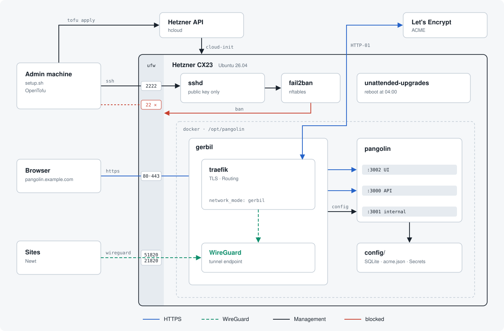

# Pangolin on Hetzner Cloud

Automated, hardened setup of a [Pangolin](https://github.com/fosrl/pangolin) server
(tunneled reverse proxy with identity management, an alternative to Cloudflare Tunnel) on a
[Hetzner Cloud](https://www.hetzner.com/cloud/) **CX23** server with Ubuntu 26.04.

One command creates the server, hardens it, starts Pangolin, waits for DNS and the
certificate, and then tests the running machine:

```bash
cp .env.example .env && chmod 600 .env   # enter token, domain, email
./setup.sh
```

---

## Contents

- [What gets set up?](#what-gets-set-up)
- [Architecture](#architecture)
- [Requirements](#requirements)
- [Quick start](#quick-start)
- [Configuration (.env)](#configuration-env)
- [setup.sh commands](#setupsh-commands)
- [Security concept](#security-concept)
- [Functional test](#functional-test)
- [Repository layout](#repository-layout)
- [Operations, updates, backup](docs/OPERATIONS.md)
- [Troubleshooting](docs/OPERATIONS.md#troubleshooting)

---

## What gets set up?

| Area | Implementation |
|---|---|
| Server | Hetzner Cloud `cx23` (2 vCPU, 4 GB RAM, 40 GB), Ubuntu 26.04, IPv4 + IPv6 |
| Provisioning | OpenTofu (Terraform-compatible) + cloud-init |
| SSH keys | Asked at start: GitHub user (`github.com/<user>.keys`) or your own public key |
| Login | SSH on **port 2222** (22 closed), user `peng` (asked at start) with sudo, root login and password login disabled |
| Firewall | **ufw on the node itself** (no Hetzner Cloud Firewall) |
| Admin access | Open everywhere at first (`ADMIN_ALLOWED_CIDRS=any`), can be restricted later |
| Brute-force protection | fail2ban: jails `sshd` (aggressive) and `recidive`, bans via nftables |
| Updates | unattended-upgrades with automatic reboot at 04:00 |
| Pangolin stack | `pangolin`, `gerbil` (WireGuard), `traefik` with Let's Encrypt, Docker Compose |
| Secrets | Server secret and setup token are generated **on the server**, not in cloud-init or tfstate |
| Tests | About 60 automatic checks, on the server and from outside |

## Architecture



The diagram reads from left to right: the peers outside, the host firewall in the
middle, the Docker stack on the right.

- **Management (neutral line):** `setup.sh` creates the server with `tofu apply` via the
  Hetzner API, and cloud-init sets it up on first boot. After that, access is only via SSH
  on port 2222 and only with a public key. Port 22 is closed.
- **ufw:** The firewall runs on the server itself, not as a Hetzner Cloud Firewall. Only
  2222/tcp, 80/tcp, 443/tcp+udp and 51820/udp and 21820/udp for WireGuard are open.
- **fail2ban (red):** reads the sshd log and bans IPs after repeated failed attempts via
  nftables. A banned IP gets "Connection refused" on 2222. This also hits your own IP
  if the local key does not match the server.
- **HTTPS (blue):** Browsers reach `traefik` via 80/443. traefik terminates TLS, gets the
  certificate from Let's Encrypt via HTTP-01 and forwards to `pangolin` (`:3002` UI,
  `:3000` API).
- **gerbil:** publishes all ports of the stack. traefik runs in its network with
  `network_mode: gerbil`. gerbil fetches its configuration internally from pangolin (`:3001`).
- **WireGuard (green):** Sites running Newt open a tunnel to gerbil. Requests to shared
  resources go from traefik through this tunnel to the site.
- **config/:** The database (SQLite), certificates (`acme.json`) and the secrets generated
  on the server live under `/opt/pangolin/config`.
- **unattended-upgrades:** installs security updates automatically and reboots at 04:00
  if needed.

What `./setup.sh` does:

1. Install local requirements from `requirements.md` (incl. OpenTofu)
2. Ask for: Hetzner API token (if not in `.env`), username on the server and SSH key source
   (GitHub user or your own key). The answers are saved to `.env` and suggested next time.
   With `AUTO_APPROVE=true` there are no prompts and the values from `.env` apply.
3. Check that the local private key matches the server keys (otherwise fail2ban would ban your IP)
4. `tofu apply`: fetch SSH keys (from GitHub or `.env`), create them in Hetzner (existing ones are reused), create the server with cloud-init
5. cloud-init: packages, user, SSH hardening, ufw, fail2ban, auto-updates, Docker, Pangolin files
6. `pangolin-bootstrap` on the server: generate secrets, pull images, start the stack
7. Wait locally for SSH → cloud-init → DNS record → valid certificate
8. Show the setup token for the first admin
9. Functional test of the running machine

## Requirements

Details in **[requirements.md](requirements.md)**. In short:

- An Ubuntu/Debian machine with sudo (the script installs the rest)
- A Hetzner Cloud API token (Read & Write)
- An SSH key pair: the public part on GitHub or as a `.pub` file, the private part locally
- A domain where you can set DNS records

## Quick start

```bash
git clone git@github.com:ratte/pangolin-hetzner-setup.git
cd pangolin-hetzner-setup
cp .env.example .env && chmod 600 .env
nano .env                      # DASHBOARD_DOMAIN, BASE_DOMAIN, LETSENCRYPT_EMAIL (HCLOUD_TOKEN optional)
./setup.sh                     # asks for the server user (suggestion: peng) and the SSH key source
```

While the script runs, it shows the server IP. Then set these records at your DNS provider:

| Name | Type | Value |
|---|---|---|
| `pangolin.example.com` (DASHBOARD_DOMAIN) | A | IPv4 of the server |
| `pangolin.example.com` | AAAA | IPv6 of the server (optional, but then correct!) |
| `*.example.com` (BASE_DOMAIN) | A | IPv4 of the server (for resources, recommended) |

The script waits until the A record is correct (max. `DNS_WAIT_TIMEOUT`), then for the
Let's Encrypt certificate. At the end you see:

```
==> Create the first admin
    URL:         https://pangolin.example.com/auth/initial-setup
    Setup token: 3f9c…
```

Create the first admin account there. `./setup.sh token` prints the token again at any
time. Then create a site in Pangolin and start **Newt** on the target system with the
values shown.

## Configuration (.env)

| Variable | Default | Meaning |
|---|---|---|
| `HCLOUD_TOKEN` | empty | Hetzner API token. If missing, the script asks for it (hidden input), checks it with Hetzner and offers to save it to `.env` |
| `DASHBOARD_DOMAIN` | – | FQDN of the dashboard (required) |
| `BASE_DOMAIN` | – | Base domain for resources (required) |
| `LETSENCRYPT_EMAIL` | – | Email for Let's Encrypt (required) |
| `SERVER_NAME` | `pangolin` | Server name/hostname |
| `SERVER_TYPE` | `cx23` | Hetzner server type |
| `LOCATION` | `nbg1` | Location (`nbg1`, `fsn1`, `hel1`, …) |
| `IMAGE` | `ubuntu-26.04` | Only Ubuntu is supported |
| `TIMEZONE` | `Europe/Zurich` | Time zone |
| `AUTO_REBOOT_TIME` | `04:00` | Reboot after kernel updates, `off` to disable |
| `PROTECTION` | `false` | Hetzner delete/rebuild protection |
| `GITHUB_USER` | empty | SSH keys from `github.com/<user>.keys` (asked) |
| `SSH_PUBLIC_KEY` | empty | Your own public key, in quotes (asked) |
| `ADMIN_USER` | `peng` | Login user on the server, asked before creation |
| `SSH_PORT` | `2222` | SSH port on the server |
| `ADMIN_ALLOWED_CIDRS` | `any` | SSH source networks at creation, several in quotes separated by spaces |
| `SSH_KEY_FILE` | – | Private key if not in the ssh-agent/default path. Must match the server keys |
| `PANGOLIN_VERSION` / `GERBIL_VERSION` / `TRAEFIK_VERSION` / `BADGER_VERSION` | see `terraform/variables.tf` | Pinned versions |
| `AUTO_APPROVE` | `false` | No prompts (also via `AUTO_APPROVE=true ./setup.sh`) |
| `DNS_WAIT_TIMEOUT` | `1800` | Max. time to wait for DNS (seconds) |
| `DNS_RESOLVER` | `1.1.1.1` | Resolver for DNS checks |

`.env` is read as a shell file: put values containing spaces in quotes.

## setup.sh commands

| Command | Effect |
|---|---|
| `./setup.sh` / `deploy` | Everything: requirements, server, waiting, token, test |
| `./setup.sh requirements` | Install local requirements only |
| `./setup.sh plan` | Show planned infrastructure changes |
| `./setup.sh test` | Functional test (report in `.state/`) |
| `./setup.sh token` | Setup token + URL for the first admin |
| `./setup.sh ssh [command]` | SSH into the server |
| `./setup.sh admin-access "<networks>"` | Restrict SSH to networks, with auto-rollback; `any` opens it again |
| `./setup.sh backup` | Back up `/opt/pangolin` to `.state/backups/` |
| `./setup.sh update` | Update containers to the versions in `.env` |
| `./setup.sh recreate` | Rebuild the server (**data is lost**, run `backup` first) |
| `./setup.sh destroy` | Delete the server and managed SSH keys |

## Security concept

- **No secrets in cloud-init/tfstate**: The Pangolin server secret
  (`openssl rand -hex 32`) and the one-time setup token are only generated on the
  server. The Hetzner API token is only in `.env` (gitignored). As a provider
  argument it does not end up in the tfstate.
- **SSH**: port 2222 (Ubuntu's socket activation on port 22, used since 24.04, is
  disabled), public key only, admin user only (default `peng`), no root, `MaxAuthTries 3`.
  Hetzner gets the keys as well, so no root password is sent by email.
- **Firewall on the node (ufw)**: all incoming traffic is blocked except the required ports.
  Docker publishes container ports through its own iptables rules, bypassing ufw.
  Here this only affects the ports that are public anyway (80/443/51820/21820). Internal
  services (Pangolin 3000–3002, Gerbil 3004, Traefik API 8080) are **not**
  published, and the test checks this from outside.
- **Admin access**: open everywhere at first (default). Restrict it with
  `./setup.sh admin-access "203.0.113.10/32"`. The script applies the rule, opens
  a **new** SSH connection to check it and only then confirms. Without confirmation
  it is rolled back automatically after 3 minutes, so you cannot lock yourself out.
- **Pangolin dashboard**: stays publicly reachable, protected by a login (enable 2FA
  in Pangolin!). An IP restriction for the dashboard is deliberately not built in:
  Newt clients connect via the same domain (`/api/v1`), and protected resources
  redirect visitors to the dashboard to log in.
  Sign-up by invitation only (`disable_signup_without_invite: true`).
- **fail2ban**: `sshd` (aggressive, 4 attempts → 1 h ban), `recidive`
  (5 bans/day → 1 week on all ports). Bans via nftables (IPv4 and IPv6).
- **Updates**: security updates daily and automatically, reboot if needed at 04:00.
  Container versions are pinned and updated deliberately with `./setup.sh update`.
- **Change protection**: `ssh_keys` and `user_data` are excluded from changes in
  OpenTofu. New GitHub keys or changed templates therefore never destroy the server
  by accident; they only apply after `./setup.sh recreate`.

## Functional test

`./setup.sh test` (also runs automatically at the end of `deploy`) checks:

**On the server** (via SSH): cloud-init/bootstrap finished, no failed units, disk
space, NTP, effective sshd configuration incl. port, ufw active with all rules,
fail2ban with both jails, unattended-upgrades, Docker, all three containers running
(incl. restart counter), Pangolin health check, internal API, Traefik ping, Gerbil
key, database, secret set, file permissions, certificate in `acme.json`, listening
ports 2222/80/443/51820/21820.

**From outside**: ports 2222/80/443 open, port 22 and internal ports 3000–3004/8080
**closed**, root login rejected, server offers public key only, DNS A/AAAA correct,
HTTP→HTTPS redirect, valid Let's Encrypt certificate (not the Traefik default
certificate), API reports `Healthy`, setup page reachable.

Exit code `0` means: all mandatory checks passed. Every run writes a report to
`.state/test-report-*.txt`.

The test also tries to log in as root and with a password on purpose. fail2ban counts
these as failed attempts, so do not run it many times in a row.

`scripts/lint.sh` checks the repository statically (Bash syntax, shellcheck, `tofu fmt`/`validate`).

## Repository layout

```
.
├── setup.sh                      # entry point for everything
├── requirements.md               # local requirements (parsed by the script)
├── .env.example                  # configuration template
├── terraform/
│   ├── versions.tf               # providers (hcloud, http)
│   ├── variables.tf              # variables with validation
│   ├── main.tf                   # SSH keys, server, cloud-init rendering
│   ├── outputs.tf
│   └── templates/
│       ├── cloud-init.yaml.tftpl
│       ├── sshd-hardening.conf.tftpl
│       ├── fail2ban-jail.local.tftpl
│       ├── settings.env.tftpl
│       ├── 52unattended-upgrades-local.tftpl
│       └── pangolin/             # docker-compose, config.yml, Traefik
├── server/                       # files that go to the server
│   ├── pangolin-bootstrap.sh     # first boot: secrets, firewall, stack
│   ├── pangolin-firewall.sh      # ufw rules (idempotent)
│   ├── pangolin-admin-access.sh  # admin networks with auto-rollback
│   ├── 21auto-upgrades-pangolin
│   └── docker-daemon.json        # log rotation
├── scripts/
│   ├── lib.sh                    # shared functions
│   ├── install-requirements.sh
│   ├── test-server.sh            # functional test (local + remote)
│   ├── remote-checks.sh          # checks on the server
│   └── lint.sh                   # static checks
└── docs/
    ├── OPERATIONS.md             # operations, updates, backup, troubleshooting
    └── architecture.svg          # architecture diagram
```
